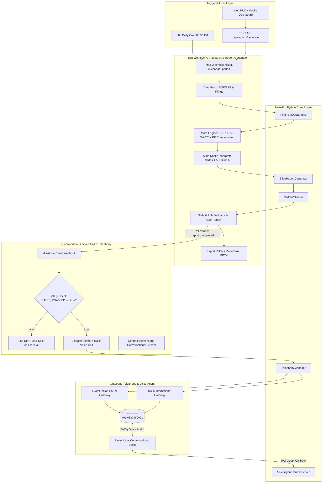

# Architecture Blueprint: AI Stock Analyst with n8n & Human-Like Voice Calls

## 1. System Overview

**F.R.I.D.A.Y. 2.0** is an enterprise-grade AI equity research engine engineered for Indian capital markets (NSE & BSE). It provides:
1. Traceable financial research with timestamped regulatory citations (BSE Corporate Announcements, SEBI filings, concall transcripts).
2. Deterministic mathematical valuation combining **2-Stage Discounted Cash Flow (DCF)** with an **11.8% Indian WACC** baseline, EPS compounding, and Sigmoid-calibrated alpha outperformance scoring.
3. Automated generation of a professional **6-Slide Institutional Presentation Deck** with strict automated compliance validation for **Slide 6: Conclusion Report**.
4. Bi-directional **n8n automation workflows** orchestrating scheduled research pipelines and live milestone status dispatches.
5. Outbound, low-latency, human-like **cellular phone calls** to the designated investor (`+91 6382480091`) powered by a two-way conversational voice agent server with fail-safe safety gating.

---

## 2. End-to-End Architecture Diagram



---

## 3. Core Engine Components

### 3.1 Financial Data Engine (`services/financial_data_engine.py`)
- **Traceability Guarantee**: Pulls market parameters directly from verified filings and historical data. Returns explicit citations with source names, filing URLs, and timestamps.
- **2-Stage DCF Model**:
  - Discrete forecast period (5 years) with explicit operational free cash flow growth.
  - Indian Equity WACC baseline: **11.8%** (10-Year Indian G-Sec Yield 7.1% + Beta $\times$ 5.5% Equity Risk Premium).
  - Terminal Growth Rate: **5.5%** (aligned with Indian long-term GDP inflation expectations).
  - Explicit Enterprise Value to Equity Value bridge (less Net Debt).
- **Target P/E Compounding**: Projects FY27 EPS based on capacity utilization and concall guidance, applying conservative terminal multiple.
- **Alpha Probability Model**: Computes Sigmoid-calibrated outperformance probability versus Nifty 50.

### 3.2 Slide Deck Generator (`services/slide_generator.py`)
Produces a complete 6-slide institutional deck conforming to `schemas/report_output_schema.json`:
- **Slide 1**: Executive Summary & Thesis
- **Slide 2**: Core Financials & Operating History
- **Slide 3**: Forensic Accounting & Governance Screen (Beneish M-Score, Cash Conversion Cycle)
- **Slide 4**: Valuation & Scenario Sensitivity Matrix (Conservative, Base, Bull DCF)
- **Slide 5**: Competitive Moat & Peer Benchmarking (ROCE, Market Share, Margin Comparison)
- **Slide 6**: **Conclusion Report — Analyst's Closing Note** (Mandatory, strictly enforced).

### 3.3 Slide 6 Automated Validator & Synthesizer (`services/slide_validator.py`)
Slide 6 is governed by non-negotiable institutional requirements:
1. **Paragraph Count**: Exactly 1 single paragraph.
2. **Word Count**: Strictly between 120 and 160 words.
3. **Core Elements**:
   - Single strongest reason justifying the stance.
   - Biggest fundamental or macro risk factor.
   - Suitability distinction (long-term wealth compounder vs. tactical trade) with clear justification.
   - Defined operational metric or trigger for future thesis review.
4. **Final Verdict Regex**: Must end with the exact pattern:
   ```regex
   Final Verdict: (STRONG BUY|BUY|HOLD|SELL|STRONG SELL) \| Conviction: (High|Medium|Low) \| Time Horizon: (3–6 months|6–12 months|3\+ years)\.
   ```
5. **Self-Repair Engine**: If an LLM response deviates (e.g. 110 words or missing verdict line), `Slide6Validator.auto_repair_slide_6()` deterministically repairs the note to satisfy all constraints without throwing fatal pipeline errors.

---

## 4. Telephony Architecture & Two-Way Voice Agent

### 4.1 Multi-Provider Telephony Manager (`services/telephony_manager.py`)
- **Safety Lock (`CALLS_ENABLED=false`)**: All dispatch requests verify the safety environment flag first. If disabled, a structured `DRY_RUN_LOGGED` payload is returned, complete with the full spoken script, timestamp, and simulated call duration.
- **Provider Support**:
  - **Exotel**: Native Indian cloud telephony platform with full DLT/TRAI SMS and voice compliance. Uses Exotel REST API to trigger conversational flows to `+91 6382480091`.
  - **Twilio**: Global PSTN carrier fallback supporting programmable voice and TwiML WebRTC streaming.
  - **ElevenLabs Conversational AI**: WebSocket bi-directional audio streaming delivering a dynamic, natural Indian female voice (e.g. Rachel / teenage conversational persona).

### 4.2 Interactive Voice Agent Context Server (`services/voice_agent_server.py`)
Handles live inbound spoken inquiries from the user during the phone call:
- **Fast In-Memory Cache**: Stores active research sessions indexed by `session_id` and ticker.
- **Domain Guardrails**:
  - *"Why did you classify this as a BUY?"*: Answers using the DCF margin of safety, ROCE spread, and order book visibility.
  - *"What is the biggest risk?"*: Articulates the single biggest threat identified in Slide 3/Slide 6.
  - *"What is WACC?"*: Spoken-friendly breakdown of Weighted Average Cost of Capital tailored for retail or institutional understanding.
  - *"Which source supports this?"*: Recites the exact timestamped filing source from the citations database.
  - *Missing Data / General Trivia*: Refuses to invent facts; gracefully admits data is unverified in the report context.
- **Spoken Delivery Timing**: Restricts answers to 1–3 clear sentences (<45 seconds) to maintain natural phone dialogue rhythm without monologuing.

---

## 5. n8n Workflow Integration

### Workflow A: `n8n/workflow_a_stock_research_report.json`
- **Trigger**: Webhook `/webhook/stock-research` or Scheduled Cron (08:30 IST).
- **Execution**:
  1. Validates input ticker, exchange, and time horizon.
  2. Dispatches `report_started` milestone call/notification.
  3. Executes data collection and financial modeling.
  4. Generates 6-slide presentation deck.
  5. Audits Slide 6 with `Slide6Validator`. If invalid, triggers `auto_repair_slide_6`.
  6. Dispatches `report_completed` milestone to Workflow B.

### Workflow B: `n8n/workflow_b_voice_call_conversation.json`
- **Trigger**: Webhook `/webhook/voice-milestone-call`.
- **Execution**:
  1. Filters by subscription event (`report_completed`, `critical_failure`).
  2. Evaluates `CALLS_ENABLED` environment variable.
  3. If enabled, dials `+91 6382480091` via Exotel or Twilio API.
  4. Binds active `session_id` to the telephony session.
  5. Routes incoming spoken audio turns to `/api/voice/session/query` for real-time conversational answers.
